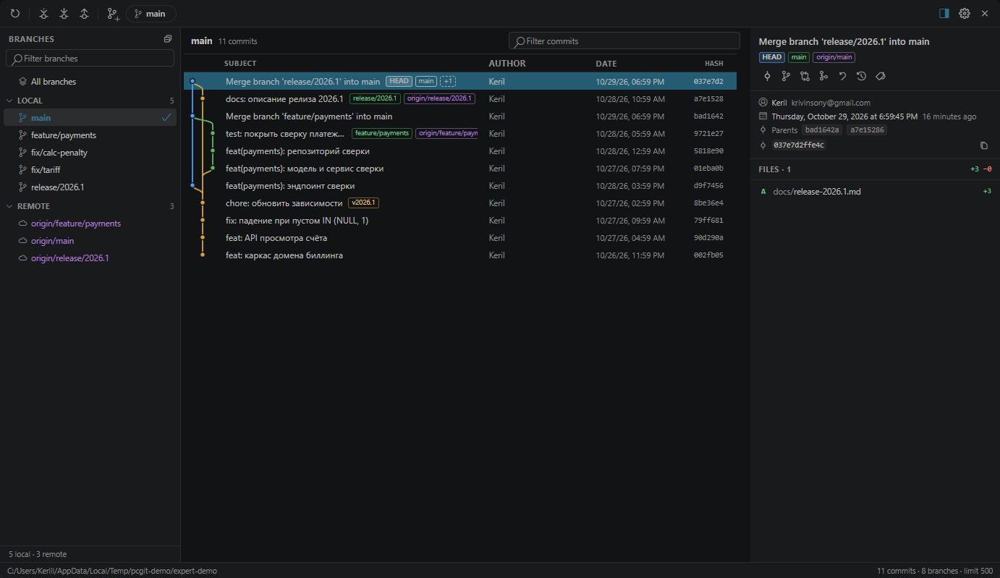

# PyCharm Git Log

Git-панель для VS Code в духе **Git tool window из PyCharm**: слева локальные и удалённые ветки, в центре лог коммитов с графом, справа детали коммита и список изменённых файлов. Всё, что нужно для повседневной работы с историей, — в одном окне: переключение веток и коммитов, merge, rebase, cherry-pick, reset, revert, теги, fetch/pull/push.



- Репозиторий: <https://github.com/DazzzleKK/pycharm-git-log>
- DSH-версия того же интерфейса: <https://github.com/DazzzleKK/dsh-code-git-workbench>
- Инструкции для агента: [AGENTS.md](AGENTS.md)

## Что уже есть

**Ветки**

- Дерево `Local` / `Remote`, фильтр по имени, текущая ветка выделена жирным.
- Двойной клик по ветке — checkout; для `origin/*` автоматически создаётся локальная tracking-ветка.
- Контекстное меню: checkout, checkout and rebase onto current, new branch from, merge into current, rebase current onto, compare with current, push, rename, delete, tag.
- Ahead/behind бейджи, пометка `gone` для удалённого upstream.

**Коммиты**

- Лог выбранной ветки (или всех веток) с цветным графом, автором, датой и хешем.
- Бейджи `HEAD`, локальных и удалённых веток, тегов на коммитах.
- Фильтр по сообщению, автору, хешу и бейджам; подгрузка «Load more».
- Панель деталей: полное сообщение, автор, дата, родители, файлы со статусами и `+/-`.
- Клик по файлу открывает нативный diff VS Code; сравнение с рабочей копией — из контекстного меню файла.
- Действия с коммитом: checkout revision, new branch, cherry-pick, merge into current, rebase onto, reset (soft/mixed/hard), revert, tag, copy hash/message.

**Репозиторий**

- Fetch all, pull, push (с автоматическим `--set-upstream` при первом пуше), выбор репозитория в multi-root workspace.
- Автообновление при возврате фокуса в окно и при изменении `.git/HEAD`, refs, index.
- Все операции — через настоящий `git`, с выводом ошибок и подтверждениями для разрушительных действий.

Панель деталей автоматически скрывается в узком окне. Вернуть её можно кнопкой справа сверху или двойным кликом по коммиту.

## Требования

- VS Code 1.90 или новее.
- Git 2.30 или новее в `PATH`.
- Node.js 20+ — только для сборки из исходников.

## Установка

### Из VSIX

Скачайте `pycharm-git-log.vsix` из раздела **Releases** на GitHub или соберите
его сами (см. ниже). Затем:

```powershell
code --install-extension pycharm-git-log.vsix
```

Либо в VS Code: `Extensions → ... → Install from VSIX...`.

### Сборка из исходников

```powershell
npm ci
npm run package
code --install-extension pycharm-git-log.vsix
```

`npm run package` выполняет проверку типов, production-сборку и упаковку VSIX.
Сам `.vsix` в репозиторий не коммитится — его прикладывают к GitHub Release.

Для разработки: откройте папку расширения в VS Code и нажмите `F5` — запустится
Extension Development Host (`.vscode/launch.json` уже настроен). Изменения в
webview подхватываются после перезапуска окна; для автоматической пересборки
используйте `npm run watch`.

### Тесты

```powershell
npm run check       # tsc --noEmit
npm run build       # сборка dist/extension.js
npm test            # интеграционный тест на временном git-репозитории
npm run test:graph  # проверка раскладки графа на случайных DAG
```

## Как открыть

- `Ctrl+Alt+G` (`Cmd+Alt+G` на macOS).
- Кнопка с иконкой ветки в заголовке Source Control.
- Командная палитра: `PyCharm Git: Open Git Log`.

## Горячие клавиши в панели

| Клавиша | Действие |
| --- | --- |
| `F5` | Обновить |
| `Ctrl/Cmd+F` | Фокус в фильтр коммитов |
| `↑` / `↓` | Перемещение по коммитам |
| `PageUp` / `PageDown` | Быстрое перемещение |
| `Home` / `End` | Первый / последний коммит |
| `Enter` | Открыть diff первого файла (или панель деталей, если она скрыта) |
| Двойной клик по коммиту | Показать детали / открыть diff |
| `Ctrl/Cmd+C` | Скопировать хеш выбранного коммита |
| `Esc` | Закрыть меню / снять фокус с фильтра |

Правый клик по ветке, коммиту или файлу открывает контекстное меню.

## Настройки

| Настройка | По умолчанию | Описание |
| --- | --- | --- |
| `pycharmGit.maxCommits` | `500` | Сколько коммитов грузить за раз |
| `pycharmGit.dateStyle` | `absolute` | `absolute` или `relative` даты |
| `pycharmGit.confirmDestructive` | `true` | Подтверждать hard reset / удаление ветки |
| `pycharmGit.autoRefreshOnFocus` | `true` | Обновлять при возврате фокуса |
| `pycharmGit.showGraph` | `true` | Показывать граф |
| `pycharmGit.remoteName` | `""` | Remote по умолчанию для push (иначе `origin`) |

## Чего пока нет

- Staging/commit UI (это отдельная вкладка Commit в PyCharm, здесь её заменяет Source Control VS Code).
- Интерактивный rebase и разрешение конфликтов внутри панели — конфликты открываются в обычном Source Control.
- Submodules, worktree-специфичные сценарии, blame.

## Похожие расширения

- **Git Graph** (MIT) — очень близкий по функциям лог с графом, но интерфейс в стиле GitKraken, без панели веток в духе PyCharm.
- **GitLens** — мощная история и blame, но проприетарная лицензия и другой UX.
- **Git History** — простой лог без операций с ветками.

Это расширение написано с нуля: собственный граф, собственный UI на webview, только `git` CLI и codicons. Код под MIT.

## Структура

```
src/git.ts        — обёртка над git CLI, парсинг веток/лога/диффов, операции
src/extension.ts  — контроллер панели, команды, content provider для diff
src/html.ts       — HTML-каркас webview
media/main.css    — тема VS Code (все цвета через --vscode-*)
media/main.js     — UI: дерево веток, таблица коммитов, детали, меню
media/graph.js    — раскладка линий графа по lane'ам
```

## Лицензия

MIT. Иконки — [codicons](https://github.com/microsoft/vscode-codicons) (MIT, Microsoft).
